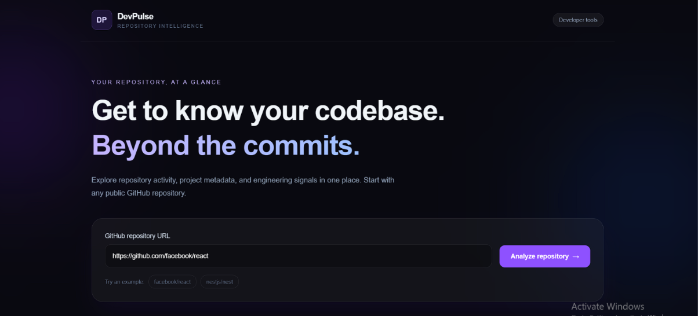
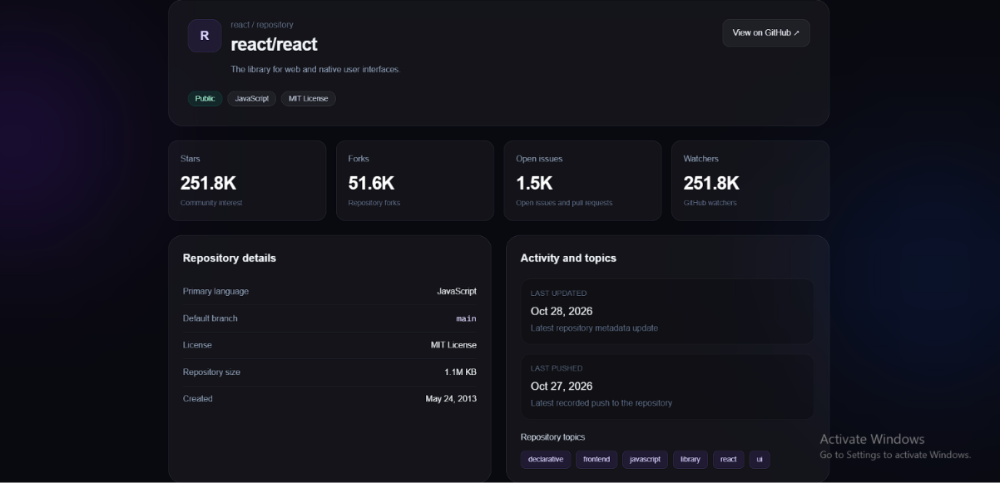
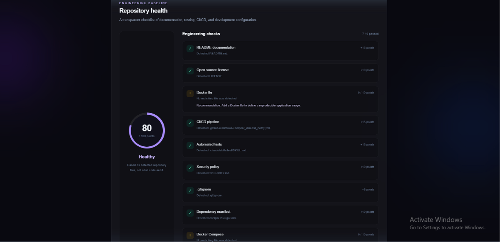
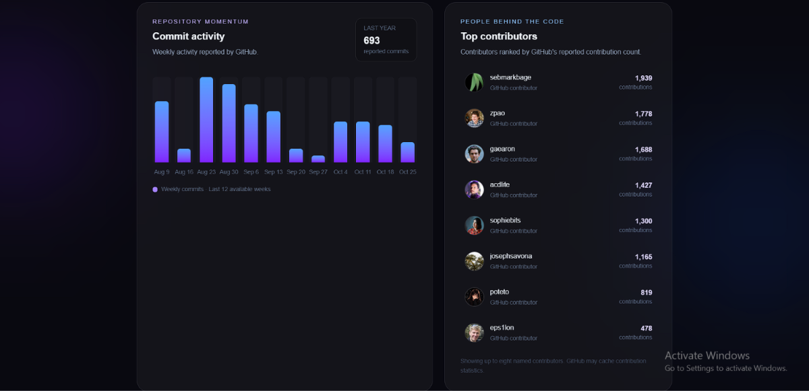
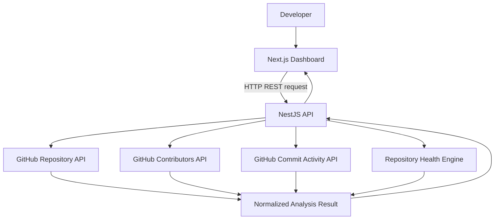

# DevPulse — GitHub Repository Health Analyzer


[](https://github.com/hassen-prog/devpulse/actions/workflows/ci.yml)


**A developer tool for understanding repository health, engineering practices, and project activity — in one dashboard.**

DevPulse analyzes public GitHub repositories and presents repository metrics, contributor statistics, commit activity, and an explainable engineering checklist with actionable recommendations.

It combines a Next.js frontend with a NestJS REST API, containerized development using Docker Compose, and automated validation through GitHub Actions.

## Screenshots

### Repository overview

Explore repository metadata, stars, forks, and other GitHub statistics in the DevPulse dashboard.



### Engineering health and activity

Inspect the repository health score, engineering checks, commit activity, and top contributors.



## Features

### Repository insights
- Analyze a public GitHub repository using its URL.
- View stars, forks, watchers, open issues, primary language, license, and repository metadata.
- Explore available weekly commit activity.
- View up to eight named contributors and their reported contribution counts.

### Engineering health score
DevPulse evaluates repository file structure and configuration against nine weighted checks:

| Engineering check | Weight |
|---|---:|
| README documentation | 15 |
| Automated test indicators | 15 |
| CI/CD configuration | 15 |
| License | 10 |
| Dockerfile | 10 |
| Security policy | 10 |
| Dependency manifest | 10 |
| Docker Compose configuration | 10 |
| `.gitignore` | 5 |
| **Total** | **100** |

The result includes a score out of 100, a health grade, detected evidence, and recommendations for missing items.

**Scoring note:** this is a file-based engineering baseline, not a complete code-quality assessment or security audit. Detecting a test file does not prove that the tests pass. Detecting a workflow does not prove that the workflow succeeds.

### Developer experience
- Dark, responsive dashboard with repository metrics and visual insights.
- Loading and error states for API requests.
- NestJS REST endpoints with input validation and error handling.
- Automated backend tests using Vitest.
- Dockerfiles and Docker Compose for repeatable execution.
- GitHub Actions workflow for backend tests and frontend/backend builds.

## Tech stack

| Area | Technologies |
|---|---|
| Frontend | Next.js, React, TypeScript, Tailwind CSS |
| Backend | NestJS, Node.js, TypeScript |
| External API | GitHub REST API |
| Testing | Vitest, NestJS testing utilities |
| Containers | Docker, Docker Compose |
| CI | GitHub Actions |
| Version control | Git, GitHub |

## Architecture



The frontend handles repository input and visualization. The backend coordinates GitHub API requests, normalizes the returned data, and calculates the health score.

Analysis results are returned to the frontend; the current version does not persist them in a database.

## Getting started

### Prerequisites

- Node.js 22 or a compatible supported version
- npm
- Docker Desktop with Docker Compose, for containerized execution
- Git

### Option 1: Run with Docker Compose

Clone the repository:

```bash
git clone https://github.com/hassen-prog/devpulse.git
cd devpulse
```

Build and start both applications:

```bash
docker compose up --build
```

Open the applications:

| Service | URL |
|---|---|
| DevPulse dashboard | http://localhost:3000 |
| Backend health endpoint | http://localhost:3001/api/health |

To stop the containers:

```bash
docker compose down
```

### Option 2: Run locally for development

#### 1. Start the backend

Open a terminal:

```bash
cd server
npm ci
npm run start:dev
```

The API runs at `http://localhost:3001`.

#### 2. Configure and start the frontend

Create `client/.env.local` with the following setting:

```env
NEXT_PUBLIC_API_URL=http://localhost:3001
```

Open a second terminal:

```bash
cd client
npm ci
npm run dev
```

Open `http://localhost:3000`.

Keep both development servers running while using the application.

## API endpoints

### Check API health

```http
GET /api/health
```

Returns the service status and a timestamp.

### Analyze a repository

```http
GET /api/repositories/analyze?url=https%3A%2F%2Fgithub.com%2Ffacebook%2Freact
```

Returns repository metadata, health checks, contributor information, and available weekly commit activity.

Only public repository analysis is supported in the current version. GitHub API rate limits and temporarily unavailable activity statistics may affect results.

## Testing

Run the backend unit tests:

```bash
cd server
npm ci
npm run test:unit
```

Build the backend:

```bash
npm run build
```

Build the frontend in another terminal:

```bash
cd client
npm ci
npm run build
```

The GitHub Actions workflow runs the backend tests and builds both applications on pushes to `main` and pull requests targeting `main`.

## Project structure

```text
devpulse/
├── .github/
│   └── workflows/
│       └── ci.yml
├── client/
│   ├── src/
│   │   ├── app/
│   │   ├── components/
│   │   ├── lib/
│   │   └── types/
│   ├── Dockerfile
│   └── package.json
├── server/
│   ├── src/
│   │   ├── repositories/
│   │   ├── app.controller.ts
│   │   └── main.ts
│   ├── Dockerfile
│   └── package.json
├── docker-compose.yml
└── README.md
```

## Engineering principles

DevPulse is being developed with an emphasis on:

- Separation of frontend, API, and analysis logic.
- Explicit TypeScript types and structured API responses.
- Handling invalid input and upstream API failures.
- Automated testing of repository analysis logic.
- Reproducible development environments.
- Continuous integration and maintainable project documentation.

## Roadmap

- [x] GitHub repository metadata integration
- [x] Repository health scoring engine
- [x] Contributor and commit activity insights
- [x] Backend unit tests
- [x] Docker-based local environment
- [x] GitHub Actions test and build workflow
- [ ] Expand automated test coverage
- [ ] Improve repository analysis and scoring accuracy
- [ ] Add repository comparison
- [ ] Add historical score tracking

## Author

**Hassen Methnani**

Built as a full-stack engineering project to explore GitHub API integration, repository analysis, testing, containerization, and continuous integration.

[GitHub profile](https://github.com/hassen-prog)
